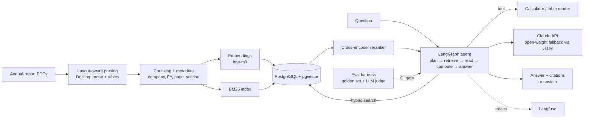

# Filing Lens

**Cited, verifiable answers about Indian listed companies, from their own annual reports.**

> 🚧 **Status: in development.** This README is the design document. Nothing below is a measured
> result yet; numbers in the evaluation section are targets.

Ask *"How did Tata Motors' debt-to-equity change between FY23 and FY25, and what reason did
management give?"* and get an answer where every claim links to the exact page and table of the
source PDF, or an explicit *"the filings don't say"*.

## Why this project

Annual reports are long (300+ pages), table-heavy and inconsistent across companies and years,
which makes them a good stress test for retrieval-augmented generation:

- answers need numbers from **tables**, not just prose,
- questions often span **several years or companies** (multi-hop),
- a fluent but wrong number is worse than no answer, so the system must **cite and abstain**.

The goal is a RAG system that is measured, not demoed: every change is scored against a fixed
evaluation set before it ships.

## What it will do

- Ingest annual-report PDFs (NSE/BSE filings) into structured chunks: prose, tables (kept as
  tables) and page metadata.
- Answer questions through an **agentic loop** that plans sub-queries, retrieves, reads tables,
  computes ratios with a calculator tool, and only then writes the answer.
- Return **citations** (company, fiscal year, page, table) for every factual sentence; refuse
  when the evidence isn't there.
- Ship with an **evaluation harness** and a CI gate that blocks regressions.
- Trace every request (prompts, retrieved chunks, tool calls, latency, cost).

## Architecture



## Tech stack

| Layer | Choice | Why |
| --- | --- | --- |
| Parsing | Docling, PyMuPDF | Keeps table structure and page numbers, which citations depend on |
| Retrieval | PostgreSQL + pgvector, BM25, `bge-m3` embeddings, `bge-reranker` cross-encoder | Hybrid search handles both exact terms (company names, line items) and paraphrase |
| Orchestration | LangGraph | Explicit, testable agent state machine instead of a free-running loop |
| LLMs | Claude API (tool use, structured output); Qwen served with vLLM as a self-hosted fallback | Compare a frontier API with an open-weight model on the same eval set |
| API / UI | FastAPI, Next.js | Streaming answers with inline citation chips |
| Evaluation | Custom golden set, RAGAS-style metrics, LLM-as-judge with human spot checks | Retrieval and generation scored separately |
| Observability | Langfuse | Per-request traces, latency and token cost |
| Delivery | Docker, GitHub Actions | Evaluation runs on every pull request |

## Evaluation plan

A hand-built golden set of **~150 questions** over 10 companies × 3 fiscal years, split into
single-fact, table lookup, multi-year comparison, multi-company, and unanswerable questions.

| Metric | What it measures | Target |
| --- | --- | --- |
| Recall@10 (retrieval) | Is the evidence retrieved at all? | ≥ 0.90 |
| Answer correctness | Exact match on numbers (±1% tolerance), judged on prose | ≥ 0.80 |
| Citation precision | Do cited pages actually support the sentence? | ≥ 0.95 |
| Abstention accuracy | Refuses on unanswerable questions | ≥ 0.90 |
| p95 latency | End-to-end, streamed | < 8 s |
| Cost per question | Tokens × price, from traces | Reported |

Ablations to report: dense-only vs hybrid, with vs without reranker, chunk size, agentic vs
single-shot RAG, Claude vs the open-weight model.

## Milestones

- [ ] Ingestion: parse 30 reports, keep tables, store with page metadata
- [ ] Golden evaluation set and harness (retrieval + generation metrics)
- [ ] Baseline single-shot RAG, first numbers
- [ ] Hybrid search + reranker, ablation table
- [ ] LangGraph agent with calculator and table tools
- [ ] Citations and abstention, citation-precision metric
- [ ] Open-weight model via vLLM, side-by-side comparison
- [ ] FastAPI + Next.js UI with streaming and citation chips
- [ ] Langfuse tracing, cost/latency dashboard
- [ ] CI gate: pull requests fail if eval scores drop

## Planned repository layout

```
filing-lens/
├── ingest/        # PDF parsing, chunking, embedding, indexing
├── retrieval/     # hybrid search, reranking
├── agent/         # LangGraph graph, tools, prompts
├── api/           # FastAPI service
├── web/           # Next.js UI
├── eval/          # golden set, metrics, reports
└── infra/         # Docker, CI
```

## Getting started

Setup instructions will land with the first working milestone.

## Author

Chirag Batra · [GitHub](https://github.com/thechiragbatra) · [LinkedIn](https://www.linkedin.com/in/chirag-batra-ds)
